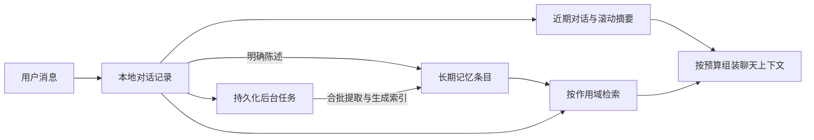

# QAgent Pet

一只常驻桌面的 AI 桌宠：透明置顶小窗 + 轻聊天 + 控制中心（Web 面板）+ 摸鱼中心（小说阅读 / 视频小窗）。**纯桌面应用**：后端为本地 FastAPI 服务，默认只监听本机回环地址，不对外提供公网入口。

## 功能

- **桌宠**：透明、无边框、置顶小窗（152×176），可拖拽移动；左键拖拽、点击打开聊天、右键呼出菜单；预设多款宠物皮肤；支持勿扰模式。
- **轻聊天与记忆**：调用 LLM（默认 MiniMax-M2.5）完成对话，展示思考态与回复。桌宠延续当前话题，也能根据授权范围回忆已记录的事实和相处经历。
- **控制中心（Web 面板）**：随桌宠本地打包加载，统一管理聊天、陪学、摸鱼与设置。
- **摸鱼中心**
  - **小说阅读**：内置书架 + 用户导入 TXT / EPUB / DOCX，自动分章、记忆阅读进度；可在桌宠隐蔽阅读窗（透明置顶小窗）中继续读，支持不透明度调节。
  - **摸鱼·视频小窗**：嵌入式浏览器加载 **B 站 / 小红书 / 抖音 / 快手**网页版，置顶小窗刷视频；小红书/抖音自动切手机版竖屏流，快手直达竖屏短视频流，天然适配小窗无需缩放；浮条含后退/前进/刷新/缩放/置顶/收起/关闭，导航栏一键切换平台；按域名注入 CSS 自动隐藏「打开App」横幅；**老板键**（`Ctrl/Cmd+Shift+Y`）一键隐藏小窗并暂停声音；记住每个渠道的上次位置、窗口尺寸与缩放；关闭即销毁窗口、停止后台播放。
  - **B 站本地播放**：粘贴 BV / av / 分 P 链接或 `b23.tv` 短链，小窗内用 **B 站官方外链播放器**直载该视频（只呈现播放器画面，不加载整站）；外链被 UP 主关闭时可通过浮条「完整页面」回退到官方视频页**裁剪模式**（隐藏侧栏/评论/推荐）；重开小窗恢复上次播放的视频、分 P 与播放模式，弹幕/自动播放为持久化偏好。全程只用官方页面与官方外链播放器，不调用任何非官方接口。
- **开源安全**：视频小窗只做「嵌平台网页 + 客户端隐藏提示」，等同用户正常浏览，不调用平台非官方接口、不抓取数据。

## 技术栈与架构

| 层 | 技术 |
| --- | --- |
| 桌面端 | Electron（多窗口：桌宠 / 聊天 / 小说 / 视频小窗 / 设置 / 控制中心） |
| 后端 | Python 3.9 · FastAPI（本地 `127.0.0.1:10000`，桌面端自动拉起） |
| 前端 | 原生 HTML / CSS / JS（控制中心面板） |
| 存储 | SQLite（对话、记忆、画像、关系、学习、小说等） |

纯桌面端：后端仅监听回环地址，不给局域网 / 公网开放。

## 项目结构

```text
.
├── main.py                  # 后端入口（FastAPI）
├── backend/
│   ├── routers/             # API 路由（会话/聊天/陪学/摸鱼/自定义宠物等）
│   └── services/            # 业务服务（LLM、记忆、情绪、小说导入/存储等）
├── desktop/
│   ├── main.js              # Electron 主进程（窗口/托盘/后端拉起）
│   ├── preload*.js          # 沙箱 preload（IPC 桥）
│   ├── feed_preload.js      # 视频小窗浮条/导航/「打开App」提示隐藏
│   └── renderer/            # 桌宠/聊天/小说/设置页面
├── frontend/                # 控制中心 Web 面板
├── requirements.txt
└── start.sh                 # 一键启动（fnm + .venv Python + npm start）
```

## 快速开始

需要 Node.js 与 Python 3.9+。

```bash
# 1. 配置环境变量（必填 LLM_API_KEY）
cp .env.example .env
# 编辑 .env，填入 LLM_API_KEY（默认 MiniMax-M2.5，获取：https://platform.minimaxi.chat/）

# 2. 安装依赖
pip install -r requirements.txt
cd desktop && npm install && cd ..

# 3. 一键启动（桌面端会自动拉起本地后端）
./start.sh
```

> 首次启动若未配置 API Key，会弹出 AI 服务设置窗口；填写后保存到 Electron 用户数据目录的 `runtime.env`，优先于项目根目录 `.env`。

## 配置

环境变量详见 `.env.example`：

- `LLM_API_KEY` / `LLM_BASE_URL` / `LLM_MODEL`：LLM 服务（默认 MiniMax-M2.5）。
- `PORT`：后端端口（默认 10000）。
- `DATABASE_URL`：SQLite 数据库路径。
- `API_KEY`：接口认证，留空为开发模式。
- `WEATHER_API_KEY`：天气查询（可选）。

## 记忆架构

对话、记忆条目、索引和待处理任务保存在本地 SQLite。聊天时，后端把当前会话的状态和相关记忆组合进模型上下文。

| 类型 | 内容 | 作用域 |
| --- | --- | --- |
| 短期记忆 | 优先保留近期完整对话轮次，并用滚动摘要延续当前事项和约束。上下文按 token 预算组装。 | 当前会话 |
| 长期记忆 | 保存事实、偏好与相处经历，记录来源、版本和有效时间。事实修正后，旧值可供历史查询。 | 明确陈述的低敏基础资料可在同一用户的宠物间共享。相处经历、私密内容和情绪快照按宠物隔离。 |



- **写入**。常见的明确事实可以当轮写入，其余提取与索引由后台任务合批处理。失败任务可重试，重启后可继续处理。相同事实合并证据，观察顺序防止延迟的旧任务覆盖新修正。[记忆提取](backend/services/memory_writer.py) · [后台任务](backend/services/memory_worker.py)
- **召回**。先检查用户和宠物的访问范围，再结合事实键、中文关键词和可选的向量相似度查找相关条目及原话片段。候选按相关性和上下文预算选取，历史记录按授权范围检索。向量服务不可用时，事实和关键词检索仍可工作。[记忆检索](backend/services/memory_retriever.py) · [上下文组装](backend/services/memory_context.py)
- **管理**。控制中心的「记忆档案」支持查看来源和历史、纠正事实、调整可共享资料的范围、标记重要和遗忘。遗忘会停止相关记忆的召回和历史回填。原始聊天记录和已有备份有独立的保留规则。[记忆接口](backend/routers/memories.py)

向量检索通过 `EMBEDDING_API_URL` 启用。聊天、模型提取和向量生成分别使用配置的模型服务。当前预算采用 UTF-8 字节数保守估算，相关配置见 [.env.example](.env.example)。

旧版数据库首次迁移前会生成一致性备份。系统保留旧对话和摘要，在后台分批回填历史消息，并归档缺少来源的旧画像。仅在旧版手工设置过的资料可能需要在记忆档案中重新确认。

## 数据与隐私

运行时数据保存在 Electron 系统 `userData` 目录：

- `runtime.env`：LLM 地址、模型与 API Key。
- `qagent_pet.db`：对话、记忆、画像、关系、学习与小说数据。
- `backups/`：每日 SQLite 一致性备份，自动保留最近 5 份。
- `config.json`：桌宠、会话、勿扰等客户端状态。
- `backend.log` / `backend_err.log`：本地运行日志。

可从托盘菜单或设置页直接打开该目录。桌宠只使用低敏信号（时间段、宠物状态、距上次互动、勿扰状态）触发气泡，不读取屏幕、窗口标题或聊天软件内容。

## 常用命令

```bash
./start.sh                    # 一键启动
cd desktop && npm start       # 仅启动桌面端
cd desktop && npm run dist    # 打包安装包（含内置后端）
```
